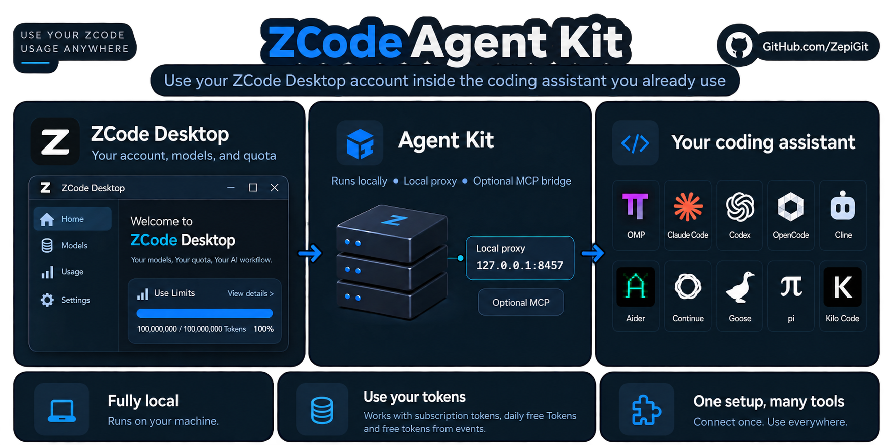

# ZCode Agent Kit
[English (original)](README.md) · **Deutsch** · [Español](README.es.md) · [日本語](README.ja.md) · [简体中文](README.zh-CN.md)

Nutze dein ZCode-Konto mit dem Coding-Assistenten, den du bereits verwendest.



*Das Kit läuft lokal; Modellanfragen gehen an ZCode.*

Das Kit startet einen kleinen Proxy auf deinem Rechner. Dein Coding-Assistent spricht mit diesem Proxy, und der Proxy leitet die Anfragen mit deinem eigenen Login an ZCode weiter. So behältst du deinen Assistenten und nutzt deine vorhandenen ZCode-Modelle und dein Kontingent. Einen Assistenten kannst du auf zwei Wegen verbinden: Du lässt das Kit die erkannten Assistenten einrichten, oder du trägst die Basis-URL und den API-Schlüssel, die das Kit ausgibt, in einen beliebigen OpenAI- oder Anthropic-kompatiblen Client ein.

## Schritt 1 — Voraussetzungen prüfen

- [ZCode Desktop](https://zcode.z.ai/en), angemeldet mit deinem eigenen Konto und mit verfügbarem Modellkontingent.
- [Node.js 24 oder neuer](https://nodejs.org/). Prüfe das mit `node --version` in einem neuen Terminal. Node.js 20 und 22 werden nicht mehr unterstützt.
- Ein separat installierter Coding-Assistent. Das Kit verbindet ihn mit ZCode.

## Schritt 2 — Kit installieren

Wähle eine der beiden Methoden und bleib auch bei Updates dabei. Der Release-Installer führt das Setup für dich aus; mit npm führst du das Setup selbst aus.

> **Bevor du den Installer ausführst:** Er lädt ein Skript herunter und führt es aus, und das Setup ändert die Konfiguration der Assistenten, denen du zustimmst. Das Setup sendet außerdem eine kleine Modellanfrage, die etwas Kontingent verbraucht. Jede Änderung wird aufgezeichnet, damit sie sich rückgängig machen lässt. Lies den Installer vorher, wenn deine Sicherheitsrichtlinie das verlangt.

**Windows — PowerShell, ohne Administratorrechte:**

```powershell
irm https://github.com/ZepiGit/ZCode-Agent-Kit/releases/latest/download/install.ps1 | iex
```

**macOS / Linux:**

```sh
curl -fsSL https://github.com/ZepiGit/ZCode-Agent-Kit/releases/latest/download/install.sh | sh
```

Der Aufruf funktioniert aus jedem Verzeichnis; du musst das Repository nicht klonen. Fehlt Bun, installiert der Installer Bun 1.4.2 für das Kit. Verwende unter Windows PowerShell, nicht Git Bash oder WSL.

**Alternative — npm (Windows, macOS und Linux):**

Benötigt [Bun](https://bun.sh/docs/installation) in deinem PATH (`bun --version`; getestet mit Bun 1.4.2).

```sh
npm install -g zcode-agent-kit@latest
zcode-kit setup --harness auto --installer
```

### Was das Setup fragt

Das Setup sucht nach installierten Assistenten und fragt, welche davon es einrichten darf. In einem normalen Terminal ist das eine Checkbox-Liste: Die Pfeiltasten bewegen die Markierung, die Leertaste setzt oder entfernt ein Häkchen, `a` schaltet alle um, Enter bestätigt. Terminals ohne Farbe oder Cursorsteuerung bekommen stattdessen eine `[y/n]`-Frage pro Assistent. Für einen Assistenten, dem du nicht zugestimmt hast, wird nichts eingerichtet.

Deine Antworten werden unter `generated/harness-choices/` gespeichert und von späteren Setups, Updates und `zcode-kit doctor --fix` wiederverwendet, sodass du nicht erneut gefragt wirst. `zcode-kit setup --reask` fragt erneut. Strg+C bricht eine Checkbox-Liste ab, die noch nicht bestätigt wurde.

Danach fragt das Setup einmal, ob der **Account Rotator** eingeschaltet werden soll. Mit ihm kann das Kit mehrere gespeicherte ZCode-Logins verwenden. Mit `y` wird dein aktueller Login importiert, und spätere Logins über `zcode-kit auth login zai` werden als zusätzliche Konten gespeichert. Du kannst das später mit `zcode-kit accounts enable` oder `disable` ändern. Einzelheiten stehen in der [Dokumentation zum Account Rotator](docs/ACCOUNT_ROTATOR.de.md).

Der Installer gibt vier nummerierte Phasen aus, eine Ergebniszeile pro Assistent, eine Verbindungsprüfung und die Verbindungsdaten. Die vollständige Ausgabe wird in der `install.log` gespeichert, die er nennt. Das Setup endet mit einer kurzen Liste von Befehlen, die du als Nächstes ausführst. Eine fehlgeschlagene Verbindungsprüfung ist eine Warnung, keine fehlgeschlagene Installation: Prüfe deinen Desktop-Login und dein Kontingent.

<details>
<summary>Unbeaufsichtigte Installationen, Installationsorte und Voraussetzungen</summary>

Ohne Terminal fragt das Setup nichts und richtet nur ein, was du nennst: Setze `ZCODE_KIT_HARNESSES=omp,codex` (oder `none`) und `ZCODE_KIT_ACCOUNT_ROTATOR=y` oder `n`. Assistenten, die du nicht genannt hast, werden übersprungen, und eine vorhandene Einstellung für den Account Rotator bleibt erhalten. `ZCODE_KIT_VERBOSE=1` gibt die vollständige Setup-Ausgabe aus, und `NO_COLOR=1` schaltet die Farbe ab.

Standardorte: `%LOCALAPPDATA%\zcode-agent-kit` unter Windows, `$HOME/.local/share/zcode-agent-kit` unter macOS und Linux. Halte dieses Verzeichnis von deinen Projekten getrennt. Gib dem Installer niemals dein Home-Verzeichnis oder einen Quellcode-Checkout als Ziel an, denn ein Update ersetzt die Dateien am Zielort.

Unter macOS und Linux werden außerdem `curl`, `tar` und ein SHA-256-Werkzeug benötigt. Für die Installation von Bun ist `unzip` nötig. Updates verwenden `rsync`, wenn es installiert ist. Die meisten Live-Tests mit echten Assistenten liefen unter Windows; die datierte [Support-Matrix](SUPPORT_MATRIX.json) führt auf, was wo getestet wurde.

</details>

## Schritt 3 — Erste Anfrage senden

Öffne ein neues Terminal **in deinem eigenen Projekt**, nicht im Kit-Verzeichnis. Verwende den Befehl für deinen Assistenten:

**OMP:**

```sh
omp -p --model zcode/glm-5.3-flash "Reply with ok"
```

**Claude Code:**

```sh
zcode-kit run claude-code -- -p "Reply with ok" --model glm-5.3-flash
```

**Codex:**

```sh
zcode-kit run codex -- exec "Reply with ok" -m glm-5.3-flash
```

Diese Befehle starten den Proxy, falls er nicht läuft. Eine Antwort mit `ok` zeigt, dass dein Konto, der Proxy und der Assistent zusammenarbeiten. Ein erfolgreiches Setup allein zeigt das nicht. Kommt keine Antwort, sieh unten unter „Hilfe“ nach; eine Neuinstallation hilft nicht, wenn das Kontingent aufgebraucht ist.

**Jeder andere Client: Basis-URL und API-Schlüssel**

Das Kit muss deinen Assistenten nicht einrichten. Starte den Proxy und übernimm die Verbindungsdaten, die er ausgibt:

```sh
zcode-kit proxy start
```

```text
Connection details (local ZCode proxy, running and verified)
  OpenAI-compatible base URL:    http://127.0.0.1:8457/v1   (POST /chat/completions, POST /responses, GET /models)
  Anthropic-compatible base URL: http://127.0.0.1:8457      (POST /v1/messages)
  API key (Bearer / x-api-key):  <your local proxy key>
  Model IDs:                     glm-5.3, glm-5.3-flash
```

Trage die Basis-URL ein, die zum API-Format deines Clients passt, den Schlüssel als API-Schlüssel oder Auth-Token und eine der Modell-IDs. `zcode-kit proxy status` gibt die Daten erneut aus. Der vollständige Schlüssel wird nur in einem interaktiven Terminal angezeigt; `zcode-kit models --show-key` gibt ihn für Skripte aus. Der Port stammt aus deiner `proxy/config.yaml`.

## Schritt 4 — In deinem Projekt verwenden

```sh
omp --model zcode/glm-5.3-flash
zcode-kit run claude-code -- --model glm-5.3-flash
```

Verwende `glm-5.3` für Text oder `glm-5.3-flash` für Text und Bilder. Ob Bilder funktionieren, hängt auch von deinem Assistenten ab.

Flash verwendet immer Thinking. Eine Anfrage, die Thinking abschaltet, wird mit der Stufe `low` gesendet; `high` und `max` werden unverändert weitergegeben. In OMP wählst du die Stufe mit `--thinking low`, `--thinking high` oder `--thinking max`. Siehe die [Zuordnung der Effort-Stufen](EFFORT_MAPPING.de.md).

Das Kit kann außerdem eine MCP-Bridge registrieren, die dem Assistenten Werkzeuge aus deiner installierten ZCode-Laufzeit anbietet. Das ist unabhängig davon, ein Modell zu verbinden; siehe die [Dokumentation zur MCP-Bridge](mcp/zcode-harness-mcp/README.de.md).

<details>
<summary>Weitere Assistenten</summary>

| Assistent | Was nach dem Setup zu tun ist |
| --- | --- |
| OpenCode | Führe `zcode-kit run opencode -- .` aus und wähle ein ZCode-Modell. |
| Aider | Führe `zcode-kit run aider -- --model openai/glm-5.3-flash` aus. |
| pi | Starte den Proxy und führe dann `pi --model zcode/glm-5.3` aus. |
| Goose | Starte den Proxy und führe dann `goose session --provider zcode` aus. |
| Continue | Öffne Continue einmal, damit seine Konfiguration existiert. Führe `zcode-kit integrate continue` aus, starte den Proxy und wähle dann das Modell in der Oberfläche. |
| Cline / Kilo Code | Das Setup schreibt die Werte nach `generated/cline-zcode-values.md` oder `generated/kilo-zcode-values.md`. Übernimm sie in die Einstellungen der Erweiterung und starte den Proxy. |

Starte OMP direkt, nicht über `zcode-kit run`. Starten mehrere OMP-Fenster im selben Moment, prüft und startet eines von ihnen den Proxy, und die anderen warten auf sein Ergebnis. Nur Claude Code, Codex, Aider und OpenCode haben einen Kit-Launcher. Unter Linux und macOS mit Node.js 26.1 oder neuer ersetzt sich `zcode-kit run` durch den Assistenten, sobald der Proxy bereit ist; neben ihm bleibt also kein Kit-Prozess bestehen. Setze `ZCODE_KIT_RESIDENT_LAUNCHER=1`, damit der Launcher als Elternprozess des Assistenten erhalten bleibt. Codex läuft mit einem eigenen Profil, deshalb werden deine persönlichen Codex-Einstellungen und Skills nicht übernommen. `zcode-kit integrate <Assistent> --dry-run` listet auf, was geschrieben würde, ohne es zu schreiben.

Dass es einen Adapter gibt, heißt nicht, dass jede Version dieses Assistenten mit einer echten Modellantwort getestet wurde. Was getestet wurde, steht in den [Assistenten-Anleitungen](harnesses/README.de.md) und in der [Support-Matrix](SUPPORT_MATRIX.json).

</details>

## Der Proxy

```sh
zcode-kit proxy start
zcode-kit proxy status
zcode-kit proxy logs 50
zcode-kit proxy restart
zcode-kit proxy stop
```

`start` und `status` geben die Verbindungsdaten aus, sobald feststeht, dass der Proxy zu dieser Installation gehört. `zcode-kit proxy status --json` gibt für Skripte ein einzelnes JSON-Objekt mit Zustand, Basis-URLs, Modell-IDs und Kontingent aus; es enthält nie den Schlüssel, und der Befehl endet nur dann mit Exit-Code 0, wenn der eigene Proxy des Kits antwortet.

<details>
<summary>Verhalten beim Stoppen, beim Neustart und bei Überlast</summary>

**Stoppen und Neustart.** Das Kit fordert seinen Proxy auf, sich zu beenden. Der Proxy gibt den Anfragen, an denen er gerade arbeitet, bis zu 6 Sekunden Zeit zum Abschluss und beendet sich innerhalb von 10 Sekunden; Anfragen, die in dieser Zeit eintreffen, erhalten HTTP 503 mit einem `Retry-After`-Header. Anfragen, die nach den 6 Sekunden noch laufen, werden abgebrochen und müssen erneut gesendet werden. Erst wenn sich der Proxy 2 Sekunden nach Ablauf seiner Frist noch nicht beendet hat, beendet das Kit den Prozess selbst.

**Das Kit beendet nur seinen eigenen Proxy.** Ein Prozess wird nur beendet, wenn er auf eine Anfrage mit dem lokalen Schlüssel als Proxy dieser Installation geantwortet hat, seine PID mit der aufgezeichneten übereinstimmt und seine Startzeit mit der beim Start aufgezeichneten übereinstimmt. Ein Proxy, der nicht mehr antwortet, wird nur beendet, wenn alles Folgende zutrifft: Die Startfrist von 60 Sekunden ist abgelaufen, seine Startzeit und seine Befehlszeile stimmen überein, und drei Gesundheitsprüfungen in Folge schlagen fehl. Alles andere, was den Port belegt, wird gemeldet und nicht angetastet.

**Unterbrochene Starts.** Wird ein Start unterbrochen, übernimmt der nächste Start, wenn er nachweisen kann, dass der frühere nicht mehr läuft. Von einem Start, der noch läuft, übernimmt er nie. Strg+C während eines Starts gibt die Startsperre sofort frei.

**Zu viele große Anfragen gleichzeitig.** Der Proxy nimmt gleichzeitig Anfragekörper von zusammen höchstens 64 MiB an. Weitere Anfragen warten bis zu 15 Sekunden auf freien Platz und werden danach mit HTTP 503 und `Retry-After: 2` beantwortet, nie mit einem Rate-Limit-Fehler. Die Grenze ist `server.admission.maxInFlightMB` in `proxy/config.yaml`.

**Automatische Neustarts.** Der Proxy fordert beim Kit einen Neustart an, wenn er nicht mehr reagiert oder wenn sein Speicherverbrauch bei drei Prüfungen im Abstand von 15 Sekunden über 1024 MB bleibt. Über 512 MB schreibt er nur eine Warnung ins Log. Innerhalb von 15 Minuten werden höchstens 3 solcher Neustarts angenommen; danach bleibt ein ausgefallener Proxy aus, bis du dir `zcode-kit proxy logs 50` ansiehst und ihn startest. Die Grenzwerte stehen unter `health.memory` in `proxy/config.yaml`.

**CAPTCHA-Solver.** Der Solver läuft in einem eigenen Prozess mit einer Speichergrenze von 300 MB (`solver.memoryCapMB` in `proxy/config.yaml`) und wird bei 50 % der Grenze durch einen neuen ersetzt. Endet er innerhalb von 10 Minuten mehr als 5-mal abnormal, werden Anfragen, die ein CAPTCHA brauchen, mit HTTP 503 und `Retry-After` beantwortet, bis das älteste dieser Prozessenden 10 Minuten zurückliegt; andere Anfragen sind nicht betroffen.

**Logs.** `logs/proxy.log` wird bei 5 MB rotiert; eine ältere Datei bleibt als `proxy.log.1` erhalten. Logdateien sind nur für deinen Benutzer lesbar, und der Proxy-Schlüssel und Tokens werden aus den Logzeilen entfernt.

</details>

## Hilfe

```sh
zcode-kit doctor
zcode-kit auth status
zcode-kit --version
```

- **Befehl nicht gefunden:** Öffne das Terminal neu. Prüfe bei Release-Installationen, ob `%LOCALAPPDATA%\Microsoft\WindowsApps` (Windows) oder `$HOME/.local/bin` (macOS und Linux) in deinem PATH steht.
- **Keine Modellantwort:** Prüfe den Desktop-Login und dein Kontingent. Starte den Proxy, wenn dein Client ihn nicht startet. Ein gesunder lokaler Proxy beweist nicht, dass das Modell erreichbar ist.
- **Proxy aus oder antwortet nicht:** Führe `zcode-kit doctor --fix` oder `zcode-kit proxy restart` aus.
- **HTTP 503 vom Proxy:** Er startet gerade neu oder ist mit großen Anfragen ausgelastet. Versuche es nach der in `Retry-After` genannten Zeit erneut.
- **401 oder Port belegt:** Suche nach einer zweiten Kit-Installation. Lösche keine Schlüssel und beende keinen Prozess, den du nicht kennst.
- **Assistent beim Setup übersprungen:** Führe `zcode-kit integrate <Assistent>` aus, oder `zcode-kit setup --reask`, um zu jedem erkannten Assistenten erneut gefragt zu werden. `zcode-kit setup --select` zeigt stattdessen eine einzige nummerierte Liste (`1,3`, `all` oder `none`).
- **Gespeicherte Antwort vergessen:** `zcode-kit doctor --forget <Assistent>` entfernt sie. Die Integration bleibt bestehen, und das nächste Setup fragt erneut.
- **Setup teilweise fehlgeschlagen:** Schlägt ein Assistent fehl, werden die anderen nicht rückgängig gemacht. Seine eigenen Teiländerungen werden zurückgenommen, und das Setup gibt den Rollback-Befehl aus.
- **Desktop-Login importieren:** `zcode-kit auth login zai --import` importiert den aktiven `zai`/`start-plan`-Login aus Desktop. Für `coding-plan`-Logins verwendest du `zcode-kit auth login zai` ohne `--import`.
- **OMP startet den Proxy nicht:** Starte OMP direkt. Liegt Node oder Bun seit dem Setup an einem anderen Ort, führe `zcode-kit setup --harness auto` erneut aus und lade die Erweiterung neu. Nach einem fehlgeschlagenen Start wartet OMP 60 Sekunden, bevor es in derselben Sitzung einen neuen Versuch macht.
- **Der Anbieter hat sein Gateway verlegt:** `zcode-kit doctor --upstream` vergleicht das Gateway, das das Kit verwendet, mit dem, das der ZCode-Client zugewiesen bekommt. Der Befehl sendet höchstens drei nicht authentifizierte Anfragen an zcode.z.ai und läuft nur, wenn du ihn aufrufst.

Exit codes: 0 ok · 1 checks failed · 2 runtime error · 3 port/foreign conflict · 4 safe-start refused · 5 auth/identity failure · 20 setup: at least one harness failed, the others are configured · 130 setup aborted with Ctrl-C (unconfirmed checkbox batch not applied; prior applied answers remain).

## Bevor du echte Projektdaten verwendest

Lass den Proxy nur auf localhost laufen und gib `.proxykey`, Anmeldedaten oder generierte Konfigurationsdateien niemals weiter.

**Lies die [Sicherheitsrichtlinie](SECURITY.de.md).** Damit deine ZCode-Sitzung funktionsfähig bleibt, führt der Proxy CAPTCHA-JavaScript des Anbieters ohne Betriebssystem-Sandbox aus. Er lauscht nur auf Loopback und verlangt den lokalen Schlüssel, aber das ist keine Prozessisolation. Das Kit umgeht keine Kontobeschränkungen und kann nicht zusagen, dass jede CAPTCHA-Prüfung gelingt.

## Kit aktualisieren oder entfernen

**Aktualisieren:** Führe `zcode-kit update` aus. Eine Release-Installation lädt das neueste Release herunter, prüft dessen SHA-256-Prüfsumme und aktualisiert sich an Ort und Stelle; eine npm-Installation installiert das Paket neu; ein Git-Checkout wird per Fast-Forward auf `origin/main` gebracht. Dein Proxy-Schlüssel, deine Konfiguration, Logs, Backups und Konten bleiben erhalten. `zcode-kit update --version vX.Y.Z` installiert eine bestimmte Version. Der Proxy wird gestoppt, bevor sich Dateien ändern, und danach wieder gestartet.

Update von 0.2.x: Installiere Node.js 24 oder neuer, **bevor** du aktualisierst. Das Update selbst läuft noch unter einem älteren Node.js, aber das anschließende Setup verweigert dort die Ausführung.

**Entfernen:** Stoppe den Proxy mit `zcode-kit proxy stop` und führe dann `zcode-kit uninstall` aus. Der Befehl macht die Änderungen an der Konfiguration deiner Assistenten rückgängig, die das Kit aufgezeichnet hat. Das Installationsverzeichnis, die Logs, der Proxy-Schlüssel und die gemeinsam genutzten Anmeldedaten bleiben bestehen, und du wirst nicht aus Desktop abgemeldet. Führe bei einer npm-Installation zusätzlich `npm uninstall -g zcode-agent-kit` aus.

## Weitere Informationen

[Assistenten-Anleitungen](harnesses/README.de.md) · [Account Rotator](docs/ACCOUNT_ROTATOR.de.md) · [MCP-Bridge](mcp/zcode-harness-mcp/README.de.md) · [So funktioniert das Kit](docs/ARCHITECTURE.md) · [Glossar](docs/GLOSSARY.md) · [Support-Matrix](SUPPORT_MATRIX.json) · [Sicherheitsrichtlinie](SECURITY.de.md) · [Lizenzen und enthaltene Komponenten](MANIFEST.de.md) · [Problem melden](https://github.com/ZepiGit/ZCode-Agent-Kit/issues)
