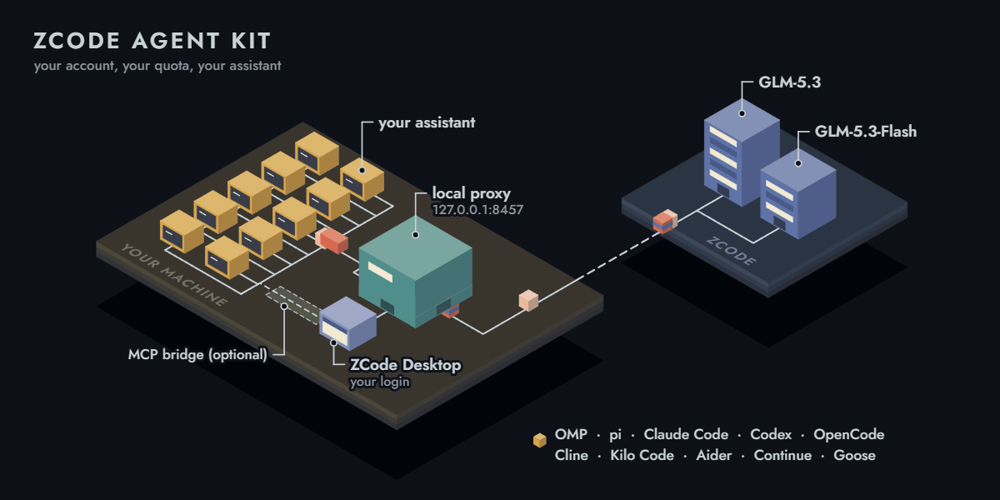

# ZCode Agent Kit
[English (original)](README.md) · [Deutsch](README.de.md) · **Español** · [日本語](README.ja.md) · [简体中文](README.zh-CN.md)

Usa tu cuenta de ZCode en Claude Code, Codex, Aider y otros asistentes de programación a través de un proxy local.



*El kit se ejecuta localmente; las solicitudes a los modelos se envían a ZCode.*

El kit inicia un pequeño proxy en tu equipo. Tu asistente de programación se comunica con ese proxy, y el proxy reenvía las solicitudes a ZCode con tu propio inicio de sesión, de modo que conservas tu asistente y usas los modelos y la cuota de ZCode que ya tienes. Hay dos formas de conectar un asistente: dejar que el kit configure los que detecte, o copiar la URL base y la clave API que imprime en cualquier cliente compatible con OpenAI o Anthropic.

## Paso 1 — Comprueba los requisitos

- [ZCode Desktop](https://zcode.z.ai/en), con sesión iniciada en tu propia cuenta y cuota disponible para los modelos.
- [Node.js 24 o posterior](https://nodejs.org/). Compruébalo con `node --version` en una terminal nueva. Node.js 20 y 22 ya no se admiten.
- Un asistente de programación instalado por separado. El kit lo conecta a ZCode.

## Paso 2 — Instala el kit

Elige uno de los dos métodos y mantenlo también para las actualizaciones. El instalador de la versión publicada ejecuta la configuración por ti; con npm la ejecutas tú.

> **Antes de ejecutar el instalador:** descarga y ejecuta un script, y el proceso de configuración modifica la configuración de los asistentes que aceptes. Además, envía una pequeña solicitud a un modelo, que consume un poco de cuota. Cada cambio queda registrado para poder revertirlo. Si tu política de seguridad lo exige, lee antes el instalador.

**Windows — PowerShell, sin permisos de administrador:**

```powershell
irm https://github.com/ZepiGit/ZCode-Agent-Kit/releases/latest/download/install.ps1 | iex
```

**macOS / Linux:**

```sh
curl -fsSL https://github.com/ZepiGit/ZCode-Agent-Kit/releases/latest/download/install.sh | sh
```


Puedes ejecutarlo desde cualquier directorio; no hace falta clonar el repositorio. Si falta Bun, el instalador instala Bun 1.4.2 para el kit. En Windows usa PowerShell, no Git Bash ni WSL.

**Alternativa — npm (Windows, macOS y Linux):**

Requiere [Bun](https://bun.sh/docs/installation) en tu PATH (`bun --version`; probado con Bun 1.4.2).

```sh
npm install -g zcode-agent-kit@latest
zcode-kit setup --harness auto --installer
```

### Qué pregunta la configuración

La configuración busca los asistentes instalados y pregunta cuáles de ellos puede configurar. En una terminal normal es una lista de casillas de verificación: las flechas mueven la selección, Espacio marca o desmarca una casilla, `a` las marca o desmarca todas y Enter confirma. Las terminales sin color o sin control del cursor reciben en su lugar una pregunta `[y/n]` por asistente. No se configura nada para un asistente que no hayas aceptado.

Tus respuestas se guardan en `generated/harness-choices/` y se reutilizan en configuraciones y actualizaciones posteriores y en `zcode-kit doctor --fix`, así que no se te vuelve a preguntar. `zcode-kit setup --reask` vuelve a preguntar. Ctrl+C cancela una lista de casillas que aún no se ha confirmado.

A continuación, la configuración pregunta una sola vez si quieres activar el **Account Rotator**, que permite al kit usar varios inicios de sesión de ZCode guardados. Si respondes `y`, se importa tu sesión actual y los inicios de sesión posteriores con `zcode-kit auth login zai` se guardan como cuentas adicionales. Puedes cambiarlo más adelante con `zcode-kit accounts enable` o `disable`. Los detalles están en la [documentación de Account Rotator](docs/ACCOUNT_ROTATOR.es.md).

El instalador imprime cuatro etapas numeradas, una línea de resultado por asistente, una comprobación de conexión y los datos de conexión. La salida completa se guarda en el `install.log` que indica. La configuración termina con una lista breve de comandos para ejecutar a continuación. Una comprobación de conexión fallida es una advertencia, no una instalación fallida: comprueba tu sesión de Desktop y tu cuota.

<details>
<summary>Instalaciones desatendidas, ubicaciones de instalación y requisitos</summary>

Sin terminal, la configuración no pregunta nada y configura solo lo que indiques: define `ZCODE_KIT_HARNESSES=omp,codex` (o `none`) y `ZCODE_KIT_ACCOUNT_ROTATOR=y` o `n`. Los asistentes que no hayas indicado se omiten, y se conserva el ajuste de Account Rotator que ya exista. `ZCODE_KIT_VERBOSE=1` imprime la salida completa de la configuración y `NO_COLOR=1` desactiva el color.

Ubicaciones predeterminadas: `%LOCALAPPDATA%\zcode-agent-kit` en Windows y `$HOME/.local/share/zcode-agent-kit` en macOS y Linux. Mantén esta carpeta separada de tus proyectos. Nunca indiques al instalador tu carpeta personal ni una copia del código fuente como destino, porque una actualización sustituye los archivos del destino.

macOS y Linux necesitan además `curl`, `tar` y una utilidad SHA-256. Para instalar Bun hace falta `unzip`. Las actualizaciones usan `rsync` si está instalado. La mayoría de las pruebas en vivo con asistentes reales se hicieron en Windows; la [matriz de compatibilidad](SUPPORT_MATRIX.json), que lleva fecha, indica qué se probó y dónde.

</details>

## Paso 3 — Envía una primera solicitud

Abre una terminal nueva **dentro de tu propio proyecto**, no en la carpeta del kit. Usa el comando que corresponda a tu asistente:

**OMP:**

```sh
omp -p --model zcode/glm-5.3-flash "Reply with ok"
```

**Claude Code:**

```sh
zcode-kit run claude-code -- -p "Reply with ok" --model glm-5.3-flash
```

**Codex:**

```sh
zcode-kit run codex -- exec "Reply with ok" -m glm-5.3-flash
```

Estos comandos inician el proxy si no está en ejecución. Una respuesta `ok` demuestra que tu cuenta, el proxy y el asistente funcionan juntos. Que la configuración termine correctamente no lo demuestra por sí solo. Si no llega ninguna respuesta, consulta «Ayuda» más abajo; reinstalar no sirve de nada cuando la cuota está agotada.

**Cualquier otro cliente: URL base y clave API**

El kit no tiene que configurar tu asistente. Inicia el proxy y copia los datos de conexión que imprime:

```sh
zcode-kit proxy start
```

```text
Connection details (local ZCode proxy, running and verified)
  OpenAI-compatible base URL:    http://127.0.0.1:8457/v1   (POST /chat/completions, POST /responses, GET /models)
  Anthropic-compatible base URL: http://127.0.0.1:8457      (POST /v1/messages)
  API key (Bearer / x-api-key):  <your local proxy key>
  Model IDs:                     glm-5.3, glm-5.3-flash
```

Introduce la URL base que corresponda al formato de API de tu cliente, la clave como clave API o token de autenticación, y uno de los ID de modelo. `zcode-kit proxy status` vuelve a imprimir los datos. La clave completa solo se muestra en una terminal interactiva; `zcode-kit models --show-key` la imprime para scripts. El puerto procede de tu `proxy/config.yaml`.

## Paso 4 — Úsalo en tu proyecto

```sh
omp --model zcode/glm-5.3-flash
zcode-kit run claude-code -- --model glm-5.3-flash
```

Usa `glm-5.3` para texto, o `glm-5.3-flash` para texto e imágenes. Que las imágenes funcionen depende también de tu asistente.

Flash siempre usa thinking. Una solicitud que desactiva thinking se envía con el nivel `low`; `high` y `max` se transmiten sin cambios. En OMP, elige el nivel con `--thinking low`, `--thinking high` o `--thinking max`. Consulta la [correspondencia de niveles de esfuerzo](EFFORT_MAPPING.md).

El kit también puede registrar un puente MCP que ofrece al asistente herramientas del entorno de ejecución de ZCode que tienes instalado. Eso es independiente de conectar un modelo; consulta la [documentación del puente MCP](mcp/zcode-harness-mcp/README.es.md).

<details>
<summary>Otros asistentes</summary>

| Asistente | Qué hacer después de la configuración |
| --- | --- |
| OpenCode | Ejecuta `zcode-kit run opencode -- .` y selecciona un modelo de ZCode. |
| Aider | Ejecuta `zcode-kit run aider -- --model openai/glm-5.3-flash`. |
| pi | Inicia el proxy y luego ejecuta `pi --model zcode/glm-5.3`. |
| Goose | Inicia el proxy y luego ejecuta `goose session --provider zcode`. |
| Continue | Abre Continue una vez para que exista su configuración. Ejecuta `zcode-kit integrate continue`, inicia el proxy y luego selecciona el modelo en la interfaz. |
| Cline / Kilo Code | La configuración escribe los valores en `generated/cline-zcode-values.md` o `generated/kilo-zcode-values.md`. Cópialos en los ajustes de la extensión e inicia el proxy. |

Inicia OMP directamente, no mediante `zcode-kit run`. Cuando varias ventanas de OMP se inician en el mismo momento, una de ellas comprueba e inicia el proxy y las demás esperan su resultado. Solo Claude Code, Codex, Aider y OpenCode tienen un lanzador del kit. En Linux y macOS con Node.js 26.1 o posterior, `zcode-kit run` se sustituye a sí mismo por el asistente cuando el proxy está listo, de modo que no queda ningún proceso del kit junto a él; define `ZCODE_KIT_RESIDENT_LAUNCHER=1` para conservar el lanzador como proceso padre del asistente. Codex se ejecuta con su propio perfil, por lo que tus ajustes y skills personales de Codex no se trasladan. `zcode-kit integrate <asistente> --dry-run` enumera lo que se escribiría, sin escribirlo.

Que exista un adaptador no significa que cada versión de ese asistente se haya probado con una respuesta real de un modelo. Las [guías de asistentes](harnesses/README.es.md) y la [matriz de compatibilidad](SUPPORT_MATRIX.json) indican qué se probó.

</details>

## El proxy

```sh
zcode-kit proxy start
zcode-kit proxy status
zcode-kit proxy logs 50
zcode-kit proxy restart
zcode-kit proxy stop
```

`start` y `status` imprimen los datos de conexión una vez confirmado que el proxy es el de esta instalación. `zcode-kit proxy status --json` imprime, para scripts, un único objeto JSON con el estado de salud, las URL base, los ID de modelo y la cuota; nunca contiene la clave y solo sale con código 0 cuando responde el proxy propio del kit.

<details>
<summary>Cómo se comportan la detención, el reinicio y la sobrecarga</summary>

**Detención y reinicio.** El kit pide a su proxy que se detenga. El proxy da a las solicitudes que está atendiendo hasta 6 segundos para terminar y se cierra en un plazo de 10 segundos; las solicitudes que llegan durante ese tiempo reciben HTTP 503 con una cabecera `Retry-After`. Las solicitudes que siguen en curso pasados los 6 segundos se cortan y hay que enviarlas de nuevo. Solo cuando el proxy no se ha cerrado 2 segundos después de vencer su plazo, el kit termina el proceso por su cuenta.

**El kit solo termina su propio proxy.** Un proceso solo se termina cuando ha respondido como el proxy de esta instalación a una solicitud con la clave local, su pid coincide con el registrado y su hora de inicio coincide con la registrada al iniciarlo. Un proxy que ya no responde solo se termina cuando se cumple todo lo siguiente: ha pasado el periodo de gracia de arranque de 60 segundos, su hora de inicio y su línea de comandos coinciden, y fallan tres comprobaciones de salud seguidas. Cualquier otra cosa que ocupe el puerto se notifica y no se toca.

**Inicios interrumpidos.** Si un inicio se interrumpe, el siguiente toma el relevo cuando puede demostrar que el anterior ya no existe. Nunca toma el relevo de un inicio que sigue en curso. Ctrl+C durante un inicio libera el bloqueo de inicio de inmediato.

**Demasiadas solicitudes grandes a la vez.** El proxy admite a la vez cuerpos de solicitud que sumen hasta 64 MiB. Las demás solicitudes esperan hasta 15 segundos a que haya sitio y después reciben HTTP 503 y `Retry-After: 2`, nunca un error de límite de frecuencia. El límite es `server.admission.maxInFlightMB` en `proxy/config.yaml`.

**Reinicios automáticos.** El proxy pide al kit un inicio nuevo cuando deja de responder, o cuando su memoria se mantiene por encima de 1024 MB durante tres comprobaciones separadas por 15 segundos. Por encima de 512 MB solo escribe una advertencia en el registro. Se aceptan como máximo 3 reinicios de este tipo en 15 minutos; después, un proxy que se haya caído sigue detenido hasta que revises `zcode-kit proxy logs 50` y lo inicies. Los límites están en `health.memory`, en `proxy/config.yaml`.

**Solucionador de CAPTCHA.** El solucionador se ejecuta en un proceso propio con un límite de memoria de 300 MB (`solver.memoryCapMB` en `proxy/config.yaml`) y se sustituye por uno nuevo al llegar al 80 % del límite. Si termina de forma anómala más de 5 veces en 10 minutos, las solicitudes que necesitan un CAPTCHA reciben HTTP 503 y `Retry-After` hasta que la más antigua de esas terminaciones tenga 10 minutos; las demás solicitudes no se ven afectadas.

**Registros.** `logs/proxy.log` se rota al llegar a 5 MB y se conserva un archivo anterior como `proxy.log.1`. Solo tu usuario puede leer los archivos de registro, y la clave del proxy y los tokens se eliminan de las líneas de registro.

</details>

## Ayuda

```sh
zcode-kit doctor
zcode-kit auth status
zcode-kit --version
```

- **No se encuentra el comando:** vuelve a abrir la terminal. En instalaciones de versión publicada, comprueba que `%LOCALAPPDATA%\Microsoft\WindowsApps` (Windows) o `$HOME/.local/bin` (macOS y Linux) esté en tu PATH.
- **El modelo no responde:** comprueba la sesión de Desktop y tu cuota. Inicia el proxy si tu cliente no lo inicia. Un proxy local en buen estado no demuestra que se pueda acceder al modelo.
- **Proxy detenido o sin respuesta:** ejecuta `zcode-kit doctor --fix` o `zcode-kit proxy restart`.
- **HTTP 503 del proxy:** se está reiniciando o está ocupado con solicitudes grandes. Vuelve a intentarlo cuando pase el tiempo indicado en `Retry-After`.
- **401 o puerto ocupado:** busca una segunda instalación del kit. No borres claves ni termines un proceso que no conozcas.
- **Asistente omitido durante la configuración:** ejecuta `zcode-kit integrate <asistente>`, o `zcode-kit setup --reask` para que se te vuelva a preguntar por cada asistente detectado. `zcode-kit setup --select` muestra en su lugar una única lista numerada (`1,3`, `all` o `none`).
- **Olvidar una respuesta guardada:** `zcode-kit doctor --forget <asistente>` la elimina. La integración se mantiene y la siguiente configuración vuelve a preguntar.
- **La configuración falló en parte:** que falle un asistente no deshace los demás. Sus propios cambios parciales se revierten, y la configuración imprime el comando de rollback.
- **Importar el inicio de sesión de Desktop:** `zcode-kit auth login zai --import` importa el inicio de sesión `zai`/`start-plan` activo en Desktop. Los inicios de sesión `coding-plan` usan `zcode-kit auth login zai` sin `--import`.
- **OMP no inicia el proxy:** inicia OMP directamente. Si Node o Bun han cambiado de ubicación desde la configuración, ejecuta de nuevo `zcode-kit setup --harness auto` y recarga la extensión. Tras un inicio fallido, OMP espera 60 segundos antes de volver a intentarlo en la misma sesión.
- **El proveedor ha trasladado su gateway:** `zcode-kit doctor --upstream` compara el gateway que usa el kit con el que recibe el cliente de ZCode. Envía como máximo tres solicitudes sin autenticar a zcode.z.ai y solo se ejecuta cuando tú lo pides.

Exit codes: 0 ok · 1 checks failed · 2 runtime error · 3 port/foreign conflict · 4 safe-start refused · 5 auth/identity failure · 20 setup: at least one harness failed, the others are configured · 130 setup aborted with Ctrl-C (unconfirmed checkbox batch not applied; prior applied answers remain).

## Antes de usar datos reales del proyecto

Mantén el proxy en localhost y nunca compartas `.proxykey`, las credenciales ni los archivos de configuración generados.

**Lee la [política de seguridad](SECURITY.es.md).** Para que tu sesión de ZCode siga funcionando, el proxy ejecuta JavaScript de CAPTCHA del proveedor sin un entorno aislado (sandbox) del sistema operativo. Solo escucha en loopback y exige la clave local, pero eso no es aislamiento de procesos. El kit no elude las restricciones de la cuenta y no puede prometer que todos los desafíos se superen.

## Actualizar o eliminar el kit

**Actualizar:** ejecuta `zcode-kit update`. Una instalación de versión publicada descarga la versión más reciente, verifica su suma de comprobación SHA-256 y se actualiza en la misma carpeta; una instalación de npm reinstala el paquete; un checkout de git se actualiza por avance rápido (fast-forward) hasta `origin/main`. Se conservan tu clave del proxy, la configuración, los registros, las copias de seguridad y las cuentas. `zcode-kit update --version vX.Y.Z` instala una versión concreta. El proxy se detiene antes de que cambien los archivos y se vuelve a iniciar después.

Si actualizas desde 0.2.x: instala Node.js 24 o posterior **antes** de actualizar. La actualización en sí todavía se ejecuta con un Node.js anterior, pero la configuración que viene a continuación se niega a ejecutarse con él.

**Eliminar:** detén el proxy con `zcode-kit proxy stop` y luego ejecuta `zcode-kit uninstall`. Revierte los cambios en la configuración de tus asistentes que el kit dejó registrados. Deja en su sitio la carpeta de instalación, los registros, la clave del proxy y las credenciales compartidas, y no cierra tu sesión de Desktop. En una instalación de npm, ejecuta además `npm uninstall -g zcode-agent-kit`.

## Más información

[Guías de asistentes](harnesses/README.es.md) · [Account Rotator](docs/ACCOUNT_ROTATOR.es.md) · [Puente MCP](mcp/zcode-harness-mcp/README.es.md) · [Cómo funciona el kit](docs/ARCHITECTURE.md) · [Glosario](docs/GLOSSARY.es.md) · [Matriz de compatibilidad](SUPPORT_MATRIX.json) · [Política de seguridad](SECURITY.es.md) · [Licencias y componentes incluidos](MANIFEST.md) · [Historial de cambios](CHANGELOG.md) · [Cómo contribuir](CONTRIBUTING.es.md) · [Preguntas e ideas](https://github.com/ZepiGit/ZCode-Agent-Kit/discussions) · [Informar de un problema](https://github.com/ZepiGit/ZCode-Agent-Kit/issues)
