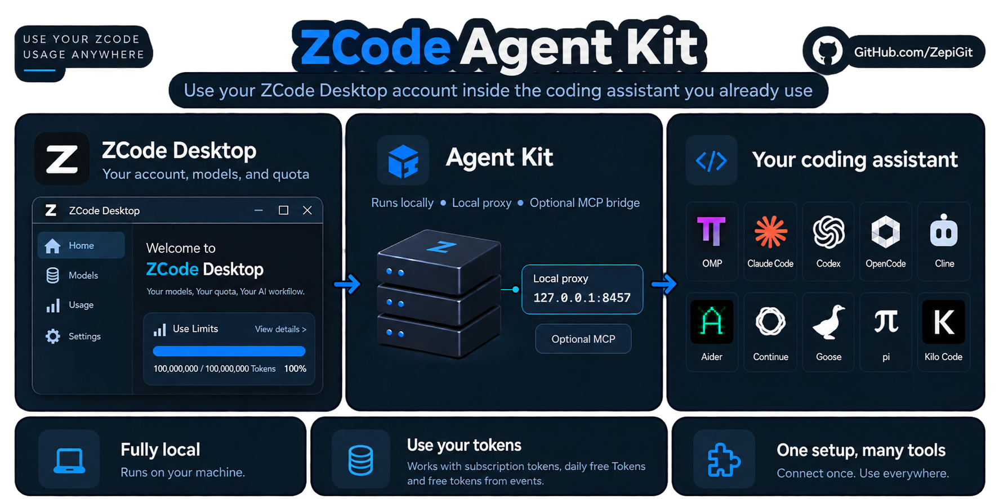

# ZCode Agent Kit
[English (original)](README.md) · [Deutsch](README.de.md) · [Español](README.es.md) · **日本語** · [简体中文](README.zh-CN.md)

普段使っているコーディングアシスタントで、自分の ZCode アカウントを利用できます。



*kit はローカルで動作し、モデルへのリクエストは ZCode に送られます。*

kit は、お使いのマシン上で小さなプロキシを起動します。コーディングアシスタントはこのプロキシと通信し、プロキシはそのリクエストをあなた自身のログインで ZCode に転送します。そのため、アシスタントはそのままで、すでに持っている ZCode のモデルと利用枠を使えます。アシスタントを接続する方法は 2 つあります。検出されたアシスタントを kit に設定させる方法と、kit が表示するベース URL と API キーを OpenAI 互換または Anthropic 互換の任意のクライアントにコピーする方法です。

## ステップ 1 — 必要なものを確認する

- [ZCode Desktop](https://zcode.z.ai/en)。自分のアカウントでログイン済みで、モデルの利用枠が残っていること。
- [Node.js 24 以降](https://nodejs.org/)。新しいターミナルで `node --version` を実行して確認します。Node.js 20 と 22 はサポート対象外になりました。
- コーディングアシスタント。別途インストールしておきます。kit はこのアシスタントを ZCode に接続します。

## ステップ 2 — kit をインストールする

次の 2 つの方法から 1 つを選び、更新のときも同じ方法を使ってください。リリース版インストーラーは、セットアップも実行します。npm の場合は、セットアップを自分で実行します。

> **インストーラーを実行する前に**：インストーラーはスクリプトをダウンロードして実行し、セットアップは同意したアシスタントの設定を変更します。セットアップはさらに小さなモデルリクエストを 1 回送信し、これが利用枠を少し消費します。変更はすべて、ロールバックできるように記録されます。セキュリティポリシーで求められている場合は、先にインストーラーを読んでください。

**Windows — PowerShell、管理者権限は不要**：

```powershell
irm https://github.com/ZepiGit/ZCode-Agent-Kit/releases/latest/download/install.ps1 | iex
```

**macOS / Linux**：

```sh
curl -fsSL https://github.com/ZepiGit/ZCode-Agent-Kit/releases/latest/download/install.sh | sh
```

どのディレクトリからでも実行できます。リポジトリをクローンする必要はありません。Bun がない場合、インストーラーは kit 用に Bun 1.4.2 をインストールします。Windows では、Git Bash や WSL ではなく PowerShell を使ってください。

**別の方法 — npm（Windows、macOS、Linux）**：

[Bun](https://bun.sh/docs/installation) が PATH 上にある必要があります（`bun --version`。Bun 1.4.2 でテスト済み）。

```sh
npm install -g zcode-agent-kit@latest
zcode-kit setup --harness auto --installer
```

### セットアップで尋ねられること

セットアップはインストール済みのアシスタントを探し、そのうちどれを設定してよいかを尋ねます。通常のターミナルでは、チェックボックスのリストが表示されます。矢印キーで移動、Space キーで選択の切り替え、`a` ですべての切り替え、Enter キーで確定です。色またはカーソル制御が使えないターミナルでは、代わりにアシスタントごとに `[y/n]` の質問が 1 つずつ表示されます。同意しなかったアシスタントには、何も設定されません。

回答は `generated/harness-choices/` に保存され、以降のセットアップ、更新、`zcode-kit doctor --fix` で再利用されるため、再び尋ねられることはありません。`zcode-kit setup --reask` を実行すると、もう一度尋ねられます。まだ確定していないチェックボックスのリストは、Ctrl-C でキャンセルできます。

続いてセットアップは、**Account Rotator** を有効にするかどうかを一度だけ尋ねます。Account Rotator を有効にすると、kit は保存済みの複数の ZCode ログインを使えるようになります。`y` と答えると現在のログインが取り込まれ、それ以降に `zcode-kit auth login zai` で行ったログインは追加のアカウントとして保存されます。この設定は、後から `zcode-kit accounts enable` または `disable` で変更できます。詳しくは [Account Rotator のドキュメント](docs/ACCOUNT_ROTATOR.md) を参照してください。

インストーラーは、番号の付いた 4 つの段階、アシスタントごとに 1 行の結果、接続チェック、接続情報を表示します。出力の全体は、インストーラーが示す `install.log` に保存されます。セットアップの最後には、次に実行するコマンドの短い一覧が表示されます。接続チェックの失敗は警告であり、インストールの失敗ではありません。Desktop のログインと利用枠を確認してください。

<details>
<summary>無人インストール、インストール先、前提条件</summary>

ターミナルがない場合、セットアップは何も尋ねず、指定されたものだけを設定します。`ZCODE_KIT_HARNESSES=omp,codex`（または `none`）と、`ZCODE_KIT_ACCOUNT_ROTATOR=y` または `n` を設定してください。指定しなかったアシスタントはスキップされ、Account Rotator を指定しなかった場合は既存の設定がそのまま維持されます。`ZCODE_KIT_VERBOSE=1` を設定するとセットアップの出力がすべて表示され、`NO_COLOR=1` を設定すると色が無効になります。

既定のインストール先は、Windows では `%LOCALAPPDATA%\zcode-agent-kit`、macOS と Linux では `$HOME/.local/share/zcode-agent-kit` です。このフォルダーは自分のプロジェクトとは別にしておいてください。インストーラーのインストール先に、ホームフォルダーやソースのチェックアウトを指定してはいけません。更新のときに、インストール先のファイルが置き換えられるためです。

macOS と Linux では、`curl`、`tar`、SHA-256 ツールも必要です。Bun のインストールには `unzip` が必要です。`rsync` がインストールされていれば、更新時にそれが使われます。実際のアシスタントを使った実地テストの大部分は、Windows で行いました。どの環境で何をテストしたかは、日付入りの [サポートマトリクス](SUPPORT_MATRIX.json) に記載しています。

</details>

## ステップ 3 — 最初のリクエストを送る

kit のフォルダーではなく、**自分のプロジェクトの中で**新しいターミナルを開きます。使っているアシスタントに対応するコマンドを実行してください。

**OMP**：

```sh
omp -p --model zcode/glm-5.3-flash "Reply with ok"
```

**Claude Code**：

```sh
zcode-kit run claude-code -- -p "Reply with ok" --model glm-5.3-flash
```

**Codex**：

```sh
zcode-kit run codex -- exec "Reply with ok" -m glm-5.3-flash
```

これらのコマンドは、プロキシが動いていなければ起動します。`ok` という返答があれば、アカウント、プロキシ、アシスタントが連携して動作していることがわかります。セットアップが成功しただけでは、そこまではわかりません。返答がない場合は、下の「困ったときは」を参照してください。利用枠を使い切っている場合、再インストールしても解決しません。

**その他のクライアント：ベース URL と API キー**

kit にアシスタントを設定させる必要はありません。プロキシを起動し、表示される接続情報をコピーしてください。

```sh
zcode-kit proxy start
```

```text
Connection details (local ZCode proxy, running and verified)
  OpenAI-compatible base URL:    http://127.0.0.1:8457/v1   (POST /chat/completions, POST /responses, GET /models)
  Anthropic-compatible base URL: http://127.0.0.1:8457      (POST /v1/messages)
  API key (Bearer / x-api-key):  <your local proxy key>
  Model IDs:                     glm-5.3, glm-5.3-flash
```

クライアントの API 形式に合うベース URL を入力し、キーを API キーまたは認証トークンとして入力し、モデル ID のいずれか 1 つを入力します。接続情報は、`zcode-kit proxy status` でもう一度表示できます。キーの全体が表示されるのは、対話的なターミナルだけです。スクリプト向けには、`zcode-kit models --show-key` がキーを出力します。ポートは `proxy/config.yaml` の設定に従います。

## ステップ 4 — 自分のプロジェクトで使う

```sh
omp --model zcode/glm-5.3-flash
zcode-kit run claude-code -- --model glm-5.3-flash
```

テキストには `glm-5.3`、テキストと画像には `glm-5.3-flash` を使います。画像を扱えるかどうかは、アシスタントにも左右されます。

Flash は常に thinking を使用します。thinking を無効にするリクエストは、`low` レベルで送信されます。`high` と `max` はそのまま渡されます。OMP では、`--thinking low`、`--thinking high`、`--thinking max` のいずれかでレベルを選びます。[effort レベルの対応表](EFFORT_MAPPING.md) を参照してください。

kit は MCP ブリッジを登録することもできます。MCP ブリッジは、インストール済みの ZCode ランタイムのツールをアシスタントに提供します。これは、モデルの接続とは別のものです。[MCP ブリッジのドキュメント](mcp/zcode-harness-mcp/README.ja.md) を参照してください。

<details>
<summary>その他のアシスタント</summary>

| アシスタント | セットアップ後に行うこと |
| --- | --- |
| OpenCode | `zcode-kit run opencode -- .` を実行し、ZCode のモデルを選びます。 |
| Aider | `zcode-kit run aider -- --model openai/glm-5.3-flash` を実行します。 |
| pi | プロキシを起動してから、`pi --model zcode/glm-5.3` を実行します。 |
| Goose | プロキシを起動してから、`goose session --provider zcode` を実行します。 |
| Continue | Continue の設定が作成されるように、Continue を一度開きます。`zcode-kit integrate continue` を実行してプロキシを起動し、UI でモデルを選びます。 |
| Cline / Kilo Code | セットアップは、設定値を `generated/cline-zcode-values.md` または `generated/kilo-zcode-values.md` に書き出します。その値を拡張機能の設定にコピーし、プロキシを起動します。 |

OMP は `zcode-kit run` を介さず、直接起動してください。複数の OMP ウィンドウが同時に起動した場合は、そのうちの 1 つがプロキシを確認して起動し、残りはその結果を待ちます。kit のランチャーがあるのは、Claude Code、Codex、Aider、OpenCode だけです。Node.js 26.1 以降を使う Linux と macOS では、プロキシの準備ができると `zcode-kit run` は自分自身をアシスタントに置き換えるため、アシスタントの横に kit のプロセスは残りません。ランチャーをアシスタントの親プロセスとして残すには、`ZCODE_KIT_RESIDENT_LAUNCHER=1` を設定してください。Codex は専用のプロファイルで動作するため、個人の Codex の設定やスキルは引き継がれません。`zcode-kit integrate <assistant> --dry-run` は、書き込まれる内容を、実際には書き込まずに一覧表示します。

アダプターがあるからといって、そのアシスタントのすべてのバージョンを実際のモデルの返答でテストしたわけではありません。何をテストしたかは、[アシスタント別ガイド](harnesses/README.ja.md) と [サポートマトリクス](SUPPORT_MATRIX.json) に記載しています。

</details>

## プロキシ

```sh
zcode-kit proxy start
zcode-kit proxy status
zcode-kit proxy logs 50
zcode-kit proxy restart
zcode-kit proxy stop
```

`start` と `status` は、プロキシがこのインストール自身のものだと確認できたときに、接続情報を表示します。`zcode-kit proxy status --json` は、スクリプト向けに、ヘルス状態、ベース URL、モデル ID、利用枠を含む JSON オブジェクトを 1 つ出力します。この出力にキーが含まれることはなく、終了コードが 0 になるのは、kit 自身のプロキシが応答した場合だけです。

<details>
<summary>停止、再起動、過負荷時の動作</summary>

**停止と再起動**：kit は、自身のプロキシに停止を依頼します。プロキシは、処理中のリクエストが完了するまで最大 6 秒待ち、10 秒以内に終了します。その間に届いたリクエストには、`Retry-After` ヘッダー付きの HTTP 503 が返されます。6 秒を過ぎても実行中のリクエストは打ち切られるため、送り直す必要があります。プロキシがその期限を 2 秒過ぎても終了していない場合に限り、kit が自らプロセスを終了させます。

**kit が終了させるのは自身のプロキシだけ**：プロセスを終了させるのは、そのプロセスがローカルキーを使った確認に対してこのインストールのプロキシとして応答し、pid が記録と一致し、開始時刻が起動時の記録と一致する場合だけです。応答しなくなったプロキシを終了させるのは、次の条件をすべて満たす場合だけです。60 秒の起動猶予期間を過ぎていること、開始時刻とコマンドラインが一致すること、ヘルスチェックが 3 回連続で失敗することです。そのポートを使っているそれ以外のものは、報告するだけで手を加えません。

**中断された起動**：起動が中断された場合、次の起動は、先の起動がもう存在しないと証明できたときに処理を引き継ぎます。まだ実行中の起動から引き継ぐことはありません。起動中に Ctrl-C を押すと、ロックは直ちに解放されます。

**大きなリクエストが同時に多すぎる場合**：プロキシが同時に受け入れるリクエストボディは、合計 64 MiB までです。それを超えるリクエストは、空きができるのを最大 15 秒待ち、その後は HTTP 503 と `Retry-After: 2` が返されます。レート制限エラーが返されることはありません。この上限は、`proxy/config.yaml` の `server.admission.maxInFlightMB` です。

**自動再起動**：プロキシは、応答しなくなったとき、または 15 秒間隔の 3 回のチェックでメモリ使用量が 1024 MB を超えたままだったときに、kit に新しい起動を依頼します。512 MB を超えた場合は、ログに警告を書き込むだけです。このような再起動が受け付けられるのは、15 分間に最大 3 回です。それ以降は、停止したプロキシは、`zcode-kit proxy logs 50` を確認して自分で起動するまで停止したままになります。これらの上限は、`proxy/config.yaml` の `health.memory` の下にあります。

**CAPTCHA ソルバー**：ソルバーは、メモリ上限が 300 MB（`proxy/config.yaml` の `solver.memoryCapMB`）の独立したプロセスで動作し、上限の 80 % に達すると新しいプロセスに置き換えられます。10 分間に 5 回を超えて異常終了した場合、CAPTCHA が必要なリクエストには、それらの終了のうち最も古いものから 10 分が経過するまで、HTTP 503 と `Retry-After` が返されます。それ以外のリクエストには影響しません。

**ログ**：`logs/proxy.log` は 5 MB でローテーションされ、古いファイルが 1 つ、`proxy.log.1` として残ります。ログファイルを読めるのは自分のユーザーだけで、プロキシキーとトークンはログの行から取り除かれます。

</details>

## 困ったときは

```sh
zcode-kit doctor
zcode-kit auth status
zcode-kit --version
```

- **コマンドが見つからない**：ターミナルを開き直してください。リリース版インストールの場合は、`%LOCALAPPDATA%\Microsoft\WindowsApps`（Windows）または `$HOME/.local/bin`（macOS と Linux）が PATH に含まれているか確認します。
- **モデルから返答がない**：Desktop のログインと利用枠を確認します。クライアントがプロキシを起動しない場合は、プロキシを起動してください。ローカルのプロキシが正常でも、モデルに到達できることの証明にはなりません。
- **プロキシが停止している、または応答しない**：`zcode-kit doctor --fix` または `zcode-kit proxy restart` を実行します。
- **プロキシが HTTP 503 を返す**：プロキシが再起動中か、大きなリクエストの処理で手一杯です。`Retry-After` に示された時間が過ぎてから再試行してください。
- **401、またはポートが使用中**：kit がもう 1 つインストールされていないか調べます。キーを削除したり、心当たりのないプロセスを終了させたりしないでください。
- **セットアップでアシスタントがスキップされた**：`zcode-kit integrate <assistant>` を実行します。または `zcode-kit setup --reask` を実行すると、検出されたすべてのアシスタントについてもう一度尋ねられます。`zcode-kit setup --select` は、代わりに番号付きのリストを 1 つ表示します（`1,3`、`all`、`none`）。
- **保存された回答を削除する**：`zcode-kit doctor --forget <assistant>` で削除できます。統合はそのまま残り、次のセットアップでもう一度尋ねられます。
- **セットアップが一部失敗した**：1 つのアシスタントが失敗しても、他のアシスタントの設定は取り消されません。失敗したアシスタント自身の途中までの変更は元に戻され、セットアップはロールバック用のコマンドを表示します。
- **Desktop のログインの取り込み**：`zcode-kit auth login zai --import` は、Desktop で現在有効な `zai`/`start-plan` ログインを取り込みます。`coding-plan` ログインの場合は、`--import` を付けずに `zcode-kit auth login zai` を使います。
- **OMP がプロキシを起動しない**：OMP を直接起動してください。セットアップの後に Node または Bun の場所が変わった場合は、`zcode-kit setup --harness auto` をもう一度実行し、拡張機能を再読み込みします。起動に失敗すると、OMP は 60 秒待ってから同じセッション内で再試行します。
- **ベンダーがゲートウェイを移した**：`zcode-kit doctor --upstream` は、kit が使うゲートウェイと、ZCode クライアントに渡されるゲートウェイを比較します。このコマンドは、zcode.z.ai に認証なしのリクエストを最大 3 回送信し、明示的に実行したときにだけ動作します。

Exit codes: 0 ok · 1 checks failed · 2 runtime error · 3 port/foreign conflict · 4 safe-start refused · 5 auth/identity failure · 20 setup: at least one harness failed, the others are configured · 130 setup aborted with Ctrl-C (unconfirmed checkbox batch not applied; prior applied answers remain).

## 実際のプロジェクトデータを使う前に

プロキシは localhost にとどめ、`.proxykey`、認証情報、生成された設定ファイルを決して共有しないでください。

**[セキュリティポリシー](SECURITY.md) を読んでください**。ZCode のセッションを維持するために、プロキシはベンダーの CAPTCHA JavaScript を、オペレーティングシステムのサンドボックスなしで実行します。プロキシはループバックでのみ待ち受け、ローカルキーを要求しますが、これはプロセスの分離ではありません。kit はアカウントの制限を回避するものではなく、すべてのチャレンジが成功することも保証できません。

## kit の更新または削除

**更新**：`zcode-kit update` を実行します。リリース版インストールでは、最新のリリースをダウンロードし、その SHA-256 チェックサムを検証して、その場で更新します。npm インストールでは、パッケージを再インストールします。git チェックアウトでは、`origin/main` まで fast-forward します。プロキシキー、設定、ログ、バックアップ、アカウントは保持されます。`zcode-kit update --version vX.Y.Z` は、指定したバージョンをインストールします。プロキシは、ファイルが変更される前に停止され、その後に再び起動されます。

0.2.x から更新する場合：更新する**前に** Node.js 24 以降をインストールしてください。更新そのものは古い Node.js でも実行されますが、それに続くセットアップは、古い Node.js では実行を拒否します。

**削除**：`zcode-kit proxy stop` でプロキシを停止してから、`zcode-kit uninstall` を実行します。このコマンドは、kit が記録しておいた、アシスタントの設定への変更をロールバックします。インストールフォルダー、ログ、プロキシキー、共有の認証情報はそのまま残り、Desktop からログアウトされることもありません。npm インストールの場合は、`npm uninstall -g zcode-agent-kit` も実行します。

## 詳細情報

[アシスタント別ガイド](harnesses/README.ja.md) · [Account Rotator](docs/ACCOUNT_ROTATOR.md) · [MCP ブリッジ](mcp/zcode-harness-mcp/README.ja.md) · [kit の仕組み](docs/ARCHITECTURE.md) · [用語集](docs/GLOSSARY.md) · [サポートマトリクス](SUPPORT_MATRIX.json) · [セキュリティポリシー](SECURITY.md) · [ライセンスと同梱コンポーネント](MANIFEST.md) · [問題を報告](https://github.com/ZepiGit/ZCode-Agent-Kit/issues)
