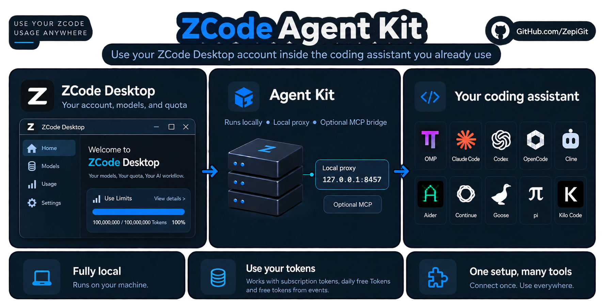

# ZCode Agent Kit
**English (original)** · [Deutsch](README.de.md) · [Español](README.es.md) · [日本語](README.ja.md) · [简体中文](README.zh-CN.md)

Use your ZCode account with the coding assistant you already use.



*The kit runs locally; model requests go to ZCode.*

The kit starts a small proxy on your machine. Your coding assistant talks to that proxy, and the proxy forwards the requests to ZCode with your own login, so you keep your assistant and use your existing ZCode models and quota. There are two ways to connect an assistant: let the kit configure the ones it detects, or copy the base URL and API key it prints into any OpenAI- or Anthropic-compatible client.

## Step 1 — Check what you need

- [ZCode Desktop](https://zcode.z.ai/en), signed in to your own account with available model quota.
- [Node.js 24 or newer](https://nodejs.org/). Check with `node --version` in a new terminal. Node.js 20 and 22 are no longer supported.
- A coding assistant, installed separately. The kit connects it to ZCode.

## Step 2 — Install the kit

Pick one of the two methods and stay with it for updates. The release installer runs setup for you; with npm you run setup yourself.

> **Before you run the installer:** it downloads and runs a script, and setup changes the configuration of the assistants you agree to. Setup also sends one small model request, which uses a little quota. Every change is recorded so it can be rolled back. If your security policy requires it, read the installer first.

**Windows — PowerShell, without administrator rights:**

```powershell
irm https://github.com/ZepiGit/ZCode-Agent-Kit/releases/latest/download/install.ps1 | iex
```

**macOS / Linux:**

```sh
curl -fsSL https://github.com/ZepiGit/ZCode-Agent-Kit/releases/latest/download/install.sh | sh
```

Run it from any directory; no clone is needed. The installer installs Bun 1.4.2 for the kit if Bun is missing. On Windows, use PowerShell, not Git Bash or WSL.

**Alternative — npm (Windows, macOS and Linux):**

Needs [Bun](https://bun.sh/docs/installation) on your PATH (`bun --version`; tested with Bun 1.4.2).

```sh
npm install -g zcode-agent-kit@latest
zcode-kit setup --harness auto --installer
```

### What setup asks

Setup looks for installed assistants and asks which of them it may configure. On a normal terminal that is a checkbox list: arrow keys move, Space toggles, `a` toggles all, Enter confirms. Terminals without colour or cursor control get one `[y/n]` question per assistant instead. Nothing is configured for an assistant you did not agree to.

Your answers are stored under `generated/harness-choices/` and reused by later setups, updates and `zcode-kit doctor --fix`, so you are not asked again. `zcode-kit setup --reask` asks again. Ctrl-C cancels a checkbox list that was not confirmed yet.

Setup then asks once whether to turn on the **Account Rotator**, which lets the kit use several saved ZCode logins. With `y`, your current login is imported and later `zcode-kit auth login zai` logins are saved as additional accounts. You can change this later with `zcode-kit accounts enable` or `disable`. Details are in the [Account Rotator documentation](docs/ACCOUNT_ROTATOR.md).

The installer prints four numbered stages, one result line per assistant, a connection check and the connection details. The full output is saved to the `install.log` it names. Setup ends with a short list of commands to run next. A failed connection check is a warning, not a failed installation: check your Desktop login and quota.

<details>
<summary>Unattended installs, install locations and prerequisites</summary>

Without a terminal, setup asks nothing and configures only what you name: set `ZCODE_KIT_HARNESSES=omp,codex` (or `none`) and `ZCODE_KIT_ACCOUNT_ROTATOR=y` or `n`. Assistants you did not name are skipped, and an existing Account Rotator setting is kept. `ZCODE_KIT_VERBOSE=1` prints the full setup output and `NO_COLOR=1` turns colour off.

Default locations: `%LOCALAPPDATA%\zcode-agent-kit` on Windows, `$HOME/.local/share/zcode-agent-kit` on macOS and Linux. Keep this folder separate from your projects. Never point the installer at your home folder or a source checkout, because an update replaces the files at the destination.

macOS and Linux also need `curl`, `tar` and a SHA-256 tool. Installing Bun needs `unzip`. Updates use `rsync` when it is installed. Most live testing with real assistants was done on Windows; the dated [support matrix](SUPPORT_MATRIX.json) lists what was tested where.

</details>

## Step 3 — Send a first request

Open a new terminal **inside your own project**, not the kit folder. Use the command for your assistant:

**OMP:**

```sh
omp -p --model zcode/glm-5.3-flash "Reply with ok"
```

**Claude Code:**

```sh
zcode-kit run claude-code -- -p "Reply with ok" --model glm-5.3-flash
```

**Codex:**

```sh
zcode-kit run codex -- exec "Reply with ok" -m glm-5.3-flash
```

These commands start the proxy if it is not running. A reply of `ok` shows that your account, the proxy and the assistant work together. A successful setup alone does not show that. If no reply comes, see "Get help" below; reinstalling does not help when the quota is used up.

**Any other client: base URL and API key**

The kit does not have to configure your assistant. Start the proxy and copy the connection details it prints:

```sh
zcode-kit proxy start
```

```text
Connection details (local ZCode proxy, running and verified)
  OpenAI-compatible base URL:    http://127.0.0.1:8457/v1   (POST /chat/completions, POST /responses, GET /models)
  Anthropic-compatible base URL: http://127.0.0.1:8457      (POST /v1/messages)
  API key (Bearer / x-api-key):  <your local proxy key>
  Model IDs:                     glm-5.3, glm-5.3-flash
```

Enter the base URL that matches your client's API format, the key as API key or auth token, and one of the model IDs. `zcode-kit proxy status` prints the details again. The full key is shown only on an interactive terminal; `zcode-kit models --show-key` prints it for scripts. The port comes from your `proxy/config.yaml`.

## Step 4 — Use it in your project

```sh
omp --model zcode/glm-5.3-flash
zcode-kit run claude-code -- --model glm-5.3-flash
```

Use `glm-5.3` for text, or `glm-5.3-flash` for text and images. Whether images work also depends on your assistant.

Flash always thinks. A request that turns thinking off is sent with the level `low`; `high` and `max` are passed through. In OMP, choose the level with `--thinking low`, `--thinking high` or `--thinking max`. See the [effort mapping](EFFORT_MAPPING.md).

The kit can also register an MCP bridge that offers tools from your installed ZCode runtime to the assistant. That is separate from connecting a model; see the [MCP bridge documentation](mcp/zcode-harness-mcp/README.md).

<details>
<summary>Other assistants</summary>

| Assistant | What to do after setup |
| --- | --- |
| OpenCode | Run `zcode-kit run opencode -- .` and select a ZCode model. |
| Aider | Run `zcode-kit run aider -- --model openai/glm-5.3-flash`. |
| pi | Start the proxy, then run `pi --model zcode/glm-5.3`. |
| Goose | Start the proxy, then run `goose session --provider zcode`. |
| Continue | Open Continue once so that its configuration exists. Run `zcode-kit integrate continue`, start the proxy, then select the model in the UI. |
| Cline / Kilo Code | Setup writes the values to `generated/cline-zcode-values.md` or `generated/kilo-zcode-values.md`. Copy them into the extension's settings and start the proxy. |

Start OMP directly, not through `zcode-kit run`. When several OMP windows start at the same moment, one of them checks and starts the proxy and the others wait for its result. Only Claude Code, Codex, Aider and OpenCode have a kit launcher. On Linux and macOS with Node.js 26.1 or newer, `zcode-kit run` replaces itself with the assistant once the proxy is ready, so no kit process stays beside it; set `ZCODE_KIT_RESIDENT_LAUNCHER=1` to keep the launcher as the assistant's parent process. Codex runs with its own profile, so your personal Codex settings and skills are not carried over. `zcode-kit integrate <assistant> --dry-run` lists what would be written without writing it.

An adapter existing does not mean every version of that assistant was tested with a real model reply. The [assistant guides](harnesses/README.md) and the [support matrix](SUPPORT_MATRIX.json) say what was tested.

</details>

## The proxy

```sh
zcode-kit proxy start
zcode-kit proxy status
zcode-kit proxy logs 50
zcode-kit proxy restart
zcode-kit proxy stop
```

`start` and `status` print the connection details once the proxy is confirmed to be this installation's own. `zcode-kit proxy status --json` prints one JSON object with health, base URLs, model IDs and quota for scripts; it never contains the key and exits 0 only when the kit's own proxy answers.

<details>
<summary>How stopping, restarting and overload behave</summary>

**Stop and restart.** The kit asks its proxy to stop. The proxy gives the requests it is working on up to 6 seconds to finish and exits within 10 seconds; requests that arrive during that time get HTTP 503 with a `Retry-After` header. Requests that are still running after the 6 seconds are cut off and need to be sent again. Only when the proxy has not exited 2 seconds after its deadline does the kit end the process itself.

**The kit only ends its own proxy.** A process is ended only when it answered as this installation's proxy with the local key, its pid matches the recorded one and its start time matches the one recorded at start. A proxy that no longer answers is ended only when all of this is true: it is past the 60-second startup grace, its start time and command line match, and three health checks in a row fail. Anything else on the port is reported and left alone.

**Interrupted starts.** If a start is interrupted, the next start takes over when it can prove the earlier one is gone. It never takes over from a start that is still running. Ctrl-C during a start releases the lock right away.

**Too many large requests at once.** The proxy admits request bodies up to 64 MiB in total at a time. Further requests wait up to 15 seconds for room and are then answered with HTTP 503 and `Retry-After: 2`, never with a rate-limit error. The limit is `server.admission.maxInFlightMB` in `proxy/config.yaml`.

**Automatic restarts.** The proxy asks the kit for a fresh start when it stops responding, or when its memory stays above 1024 MB for three checks 15 seconds apart. Above 512 MB it only writes a warning to the log. At most 3 such restarts are accepted within 15 minutes; after that a proxy that went down stays down until you look at `zcode-kit proxy logs 50` and start it. The limits are under `health.memory` in `proxy/config.yaml`.

**CAPTCHA solver.** The solver runs in a process of its own with a memory cap of 300 MB (`solver.memoryCapMB` in `proxy/config.yaml`) and is replaced by a fresh one at 50 % of the cap. If it ends abnormally more than 5 times within 10 minutes, requests that need a CAPTCHA are answered with HTTP 503 and `Retry-After` until the oldest of those exits is 10 minutes old; other requests are not affected.

**Logs.** `logs/proxy.log` is rotated at 5 MB, with one older file kept as `proxy.log.1`. Log files are readable by your user only, and the proxy key and tokens are removed from log lines.

</details>

## Get help

```sh
zcode-kit doctor
zcode-kit auth status
zcode-kit --version
```

- **Command not found:** reopen the terminal. For release installs, check that `%LOCALAPPDATA%\Microsoft\WindowsApps` (Windows) or `$HOME/.local/bin` (macOS and Linux) is on your PATH.
- **No model reply:** check the Desktop login and your quota. Start the proxy if your client does not start it. A healthy local proxy does not prove that the model can be reached.
- **Proxy down or not answering:** run `zcode-kit doctor --fix` or `zcode-kit proxy restart`.
- **HTTP 503 from the proxy:** it is restarting or busy with large requests. Retry after the time in `Retry-After`.
- **401 or the port is in use:** look for a second kit installation. Do not delete keys or end a process you do not know.
- **Assistant skipped during setup:** run `zcode-kit integrate <assistant>`, or `zcode-kit setup --reask` to be asked about every detected assistant again. `zcode-kit setup --select` shows one numbered list instead (`1,3`, `all` or `none`).
- **Forget a stored answer:** `zcode-kit doctor --forget <assistant>` removes it. The integration stays and the next setup asks again.
- **Setup partly failed:** one assistant failing does not undo the others. Its own partial changes are reverted, and setup prints the rollback command.
- **Desktop login import:** `zcode-kit auth login zai --import` imports the active Desktop `zai`/`start-plan` login. `coding-plan` logins use `zcode-kit auth login zai` without `--import`.
- **OMP does not start the proxy:** start OMP directly. If Node or Bun moved since setup, run `zcode-kit setup --harness auto` again and reload the extension. After a failed start, OMP waits 60 seconds before it tries again in the same session.
- **The vendor moved its gateway:** `zcode-kit doctor --upstream` compares the gateway the kit uses with the one the ZCode client is given. It sends at most three unauthenticated requests to zcode.z.ai and runs only when you ask for it.

Exit codes: 0 ok · 1 checks failed · 2 runtime error · 3 port/foreign conflict · 4 safe-start refused · 5 auth/identity failure · 20 setup: at least one harness failed, the others are configured · 130 setup aborted with Ctrl-C (unconfirmed checkbox batch not applied; prior applied answers remain).

## Before you use real project data

Keep the proxy on localhost and never share `.proxykey`, credentials or generated configuration files.

**Read the [security policy](SECURITY.md).** To keep your ZCode session working, the proxy runs CAPTCHA JavaScript from the vendor without an operating-system sandbox. It listens on loopback only and requires the local key, but that is not process isolation. The kit does not get around account restrictions and cannot promise that every challenge succeeds.

## Update or remove the kit

**Update:** run `zcode-kit update`. A release installation downloads the latest release, verifies its SHA-256 checksum and updates in place; an npm installation reinstalls the package; a git checkout fast-forwards to `origin/main`. Your proxy key, configuration, logs, backups and accounts are kept. `zcode-kit update --version vX.Y.Z` installs a specific version. The proxy is stopped before files change and started again afterwards.

Updating from 0.2.x: install Node.js 24 or newer **before** you update. The update itself still runs on an older Node.js, but the setup that follows refuses to run there.

**Remove:** stop the proxy with `zcode-kit proxy stop`, then run `zcode-kit uninstall`. It rolls back the changes the kit recorded in your assistants' configuration. It leaves the installation folder, logs, the proxy key and the shared credentials in place and does not log you out of Desktop. For an npm installation, also run `npm uninstall -g zcode-agent-kit`.

## More information

[Assistant guides](harnesses/README.md) · [Account Rotator](docs/ACCOUNT_ROTATOR.md) · [MCP bridge](mcp/zcode-harness-mcp/README.md) · [How the kit works](docs/ARCHITECTURE.md) · [Glossary](docs/GLOSSARY.md) · [Support matrix](SUPPORT_MATRIX.json) · [Security policy](SECURITY.md) · [Licensing and bundled components](MANIFEST.md) · [Report a problem](https://github.com/ZepiGit/ZCode-Agent-Kit/issues)
