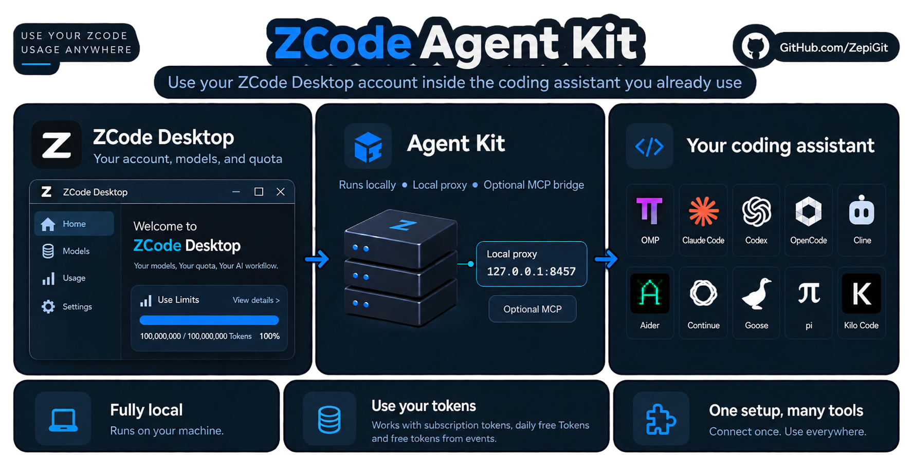

# ZCode Agent Kit
[English (original)](README.md) · [Deutsch](README.de.md) · [Español](README.es.md) · [日本語](README.ja.md) · **简体中文**

通过本地代理，在 Claude Code、Codex、Aider 等编程助手中使用你的 ZCode 账号。



*Kit 在本机运行；模型请求会发送到 ZCode。*

Kit 会在你的电脑上启动一个小型代理。编程助手与这个代理通信，代理再用你自己的登录把请求转发给 ZCode。这样你可以继续使用原来的助手，同时用上已有的 ZCode 模型和额度。连接助手有两种方式：让 Kit 配置它检测到的助手，或者把它输出的基础 URL 和 API 密钥复制到任意兼容 OpenAI 或 Anthropic 的客户端中。

## 第 1 步 — 检查所需条件

- [ZCode Desktop](https://zcode.z.ai/en)：已登录自己的账号，且有可用的模型额度。
- [Node.js 24 或更高版本](https://nodejs.org/)：在新终端中运行 `node --version` 检查。Node.js 20 和 22 已不再受支持。
- 一个编程助手，需另行安装。Kit 会把它连接到 ZCode。

## 第 2 步 — 安装 Kit

从两种方式中选一种，以后更新时也用同一种方式。正式版安装器会替你运行设置；使用 npm 时，需要自己运行设置。

> **运行安装器之前**：安装器会下载并运行一个脚本，设置程序会修改你同意配置的那些助手的配置。设置程序还会发送一个小的模型请求，这会消耗少量额度。每项更改都会被记录下来，以便回滚。如果你的安全政策有要求，请先阅读安装器的内容。

**Windows — PowerShell，无须管理员权限**：

```powershell
irm https://github.com/ZepiGit/ZCode-Agent-Kit/releases/latest/download/install.ps1 | iex
```

**macOS / Linux**：

```sh
curl -fsSL https://github.com/ZepiGit/ZCode-Agent-Kit/releases/latest/download/install.sh | sh
```

可以在任意目录运行，无须克隆仓库。如果没有 Bun，安装器会为 Kit 安装 Bun 1.4.2。在 Windows 上请使用 PowerShell，不要使用 Git Bash 或 WSL。

**另一种方式 — npm（Windows、macOS 和 Linux）**：

需要 PATH 中有 [Bun](https://bun.sh/docs/installation)（`bun --version`；已用 Bun 1.4.2 测试）。

```sh
npm install -g zcode-agent-kit@latest
zcode-kit setup --harness auto --installer
```

### 设置时会问什么

设置程序会查找已安装的助手，并询问可以配置其中哪些。在普通终端上，这是一个复选框列表：方向键移动，空格键切换选中状态，`a` 切换全部，回车键确认。在不支持颜色或光标控制的终端上，则改为对每个助手提一个 `[y/n]` 问题。对于你没有同意的助手，不会做任何配置。

你的回答保存在 `generated/harness-choices/` 下，之后的设置、更新和 `zcode-kit doctor --fix` 都会沿用，因此不会再次询问。`zcode-kit setup --reask` 会重新询问。尚未确认的复选框列表可以用 Ctrl-C 取消。

随后，设置程序会询问一次是否开启**账号轮换（Account Rotator）**，开启后 Kit 可以使用多个已保存的 ZCode 登录。回答 `y` 后，当前登录会被导入，之后用 `zcode-kit auth login zai` 进行的登录会保存为额外账号。以后可以用 `zcode-kit accounts enable` 或 `disable` 更改这一设置。详见[账号轮换文档](docs/ACCOUNT_ROTATOR.zh-CN.md)。

安装器会输出四个带编号的阶段、每个助手一行结果、一次连接检查以及连接详情。完整输出保存在安装器给出的 `install.log` 中。设置结束时会列出接下来要运行的几条命令。连接检查失败只是警告，不代表安装失败：请检查 Desktop 登录和额度。

<details>
<summary>无人值守安装、安装位置与前置条件</summary>

没有终端时，设置程序不会提问，只配置你指定的内容：设置 `ZCODE_KIT_HARNESSES=omp,codex`（或 `none`），并设置 `ZCODE_KIT_ACCOUNT_ROTATOR=y` 或 `n`。未指定的助手会被跳过；未指定账号轮换时，已有的账号轮换设置保持不变。`ZCODE_KIT_VERBOSE=1` 会显示设置的完整输出，`NO_COLOR=1` 会关闭颜色。

默认位置：Windows 上为 `%LOCALAPPDATA%\zcode-agent-kit`，macOS 和 Linux 上为 `$HOME/.local/share/zcode-agent-kit`。请让这个文件夹与你的项目分开。切勿把安装器的目标位置指向主目录或源码检出目录，因为更新会替换目标位置的文件。

macOS 和 Linux 还需要 `curl`、`tar` 和一个 SHA-256 工具。安装 Bun 需要 `unzip`。如果装有 `rsync`，更新时会使用它。使用真实助手的实际测试大多在 Windows 上完成；带日期的[支持矩阵](SUPPORT_MATRIX.json)列出了在哪些环境测试了什么。

</details>

## 第 3 步 — 发送第一个请求

在**你自己的项目目录内**打开一个新终端，不要在 Kit 文件夹内打开。使用与你的助手对应的命令：

**OMP**：

```sh
omp -p --model zcode/glm-5.3-flash "Reply with ok"
```

**Claude Code**：

```sh
zcode-kit run claude-code -- -p "Reply with ok" --model glm-5.3-flash
```

**Codex**：

```sh
zcode-kit run codex -- exec "Reply with ok" -m glm-5.3-flash
```

如果代理没有运行，这些命令会启动它。收到 `ok` 回复，说明你的账号、代理和助手能够协同工作。仅仅设置成功并不能说明这一点。如果没有收到回复，请参阅下方的“获取帮助”；额度用完时，重新安装无济于事。

**其他任何客户端：基础 URL 和 API 密钥**

不一定要由 Kit 来配置你的助手。启动代理，并复制它输出的连接详情：

```sh
zcode-kit proxy start
```

```text
Connection details (local ZCode proxy, running and verified)
  OpenAI-compatible base URL:    http://127.0.0.1:8457/v1   (POST /chat/completions, POST /responses, GET /models)
  Anthropic-compatible base URL: http://127.0.0.1:8457      (POST /v1/messages)
  API key (Bearer / x-api-key):  <your local proxy key>
  Model IDs:                     glm-5.3, glm-5.3-flash
```

填入与客户端 API 格式相符的基础 URL，把密钥填为 API 密钥或认证令牌，再填入其中一个模型 ID。`zcode-kit proxy status` 会再次输出这些详情。完整密钥只在交互式终端上显示；`zcode-kit models --show-key` 可为脚本输出完整密钥。端口取自你的 `proxy/config.yaml`。

## 第 4 步 — 在自己的项目中使用

```sh
omp --model zcode/glm-5.3-flash
zcode-kit run claude-code -- --model glm-5.3-flash
```

处理文本用 `glm-5.3`，处理文本和图片用 `glm-5.3-flash`。图片能否使用还取决于你的助手。

Flash 始终启用 thinking。关闭 thinking 的请求会以 `low` 级别发送；`high` 和 `max` 原样传递。在 OMP 中，用 `--thinking low`、`--thinking high` 或 `--thinking max` 选择级别。参见 [effort 级别对照表](EFFORT_MAPPING.md)。

Kit 还可以注册一个 MCP 桥接，把你已安装的 ZCode 运行时中的工具提供给助手。这与连接模型是两回事；参见 [MCP 桥接文档](mcp/zcode-harness-mcp/README.zh-CN.md)。

<details>
<summary>其他助手</summary>

| 助手 | 设置后的操作 |
| --- | --- |
| OpenCode | 运行 `zcode-kit run opencode -- .`，然后选择一个 ZCode 模型。 |
| Aider | 运行 `zcode-kit run aider -- --model openai/glm-5.3-flash`。 |
| pi | 启动代理，然后运行 `pi --model zcode/glm-5.3`。 |
| Goose | 启动代理，然后运行 `goose session --provider zcode`。 |
| Continue | 先打开一次 Continue，让它生成自己的配置。运行 `zcode-kit integrate continue`，启动代理，然后在界面中选择模型。 |
| Cline / Kilo Code | 设置程序会把配置值写入 `generated/cline-zcode-values.md` 或 `generated/kilo-zcode-values.md`。把这些值复制到扩展的设置中，然后启动代理。 |

请直接启动 OMP，不要通过 `zcode-kit run` 启动。多个 OMP 窗口同时启动时，其中一个负责检查并启动代理，其余的等待它的结果。只有 Claude Code、Codex、Aider 和 OpenCode 有 Kit 启动器。在使用 Node.js 26.1 或更高版本的 Linux 和 macOS 上，代理就绪后 `zcode-kit run` 会把自身替换为助手，因此助手旁边不会留下 Kit 进程；设置 `ZCODE_KIT_RESIDENT_LAUNCHER=1` 可以让启动器作为助手的父进程保留下来。Codex 使用一套独立的配置运行，因此你个人的 Codex 设置和技能不会带过来。`zcode-kit integrate <assistant> --dry-run` 会列出将要写入的内容，但不实际写入。

有适配器并不代表该助手的每个版本都用真实的模型回复测试过。测试过的内容见[助手指南](harnesses/README.zh-CN.md)和[支持矩阵](SUPPORT_MATRIX.json)。

</details>

## 代理

```sh
zcode-kit proxy start
zcode-kit proxy status
zcode-kit proxy logs 50
zcode-kit proxy restart
zcode-kit proxy stop
```

确认代理属于本安装后，`start` 和 `status` 会输出连接详情。`zcode-kit proxy status --json` 会输出一个供脚本使用的 JSON 对象，其中包含健康状态、基础 URL、模型 ID 和额度；它从不包含密钥，并且只有在 Kit 自己的代理有应答时退出码才为 0。

<details>
<summary>停止、重启和过载时的行为</summary>

**停止与重启**：Kit 会请求自己的代理停止。代理给正在处理的请求最多 6 秒时间完成，并在 10 秒内退出；这段时间内到达的请求会收到带 `Retry-After` 头的 HTTP 503。6 秒后仍在运行的请求会被中断，需要重新发送。只有当代理超过这个期限 2 秒仍未退出时，Kit 才会自行终止该进程。

**Kit 只终止自己的代理**：只有同时满足以下条件，Kit 才会终止一个进程：它在使用本地密钥的检查中以本安装的代理身份作出了应答，它的 pid 与记录一致，并且它的启动时间与启动时记录的一致。对于不再应答的代理，只有以下条件全部成立时才会终止它：已超过 60 秒的启动宽限期，启动时间和命令行都一致，并且连续三次健康检查失败。对于该端口上的其他任何东西，Kit 只会报告，不会去动它。

**被中断的启动**：如果一次启动被中断，只要能证明前一次启动已经不存在，下一次启动就会接手。它绝不会从仍在运行的启动那里接手。启动过程中按 Ctrl-C 会立即释放锁。

**同时有太多大请求**：代理同一时间接纳的请求体总计不超过 64 MiB。超出的请求会等待空位，最多等 15 秒，之后会收到 HTTP 503 和 `Retry-After: 2`，而绝不会收到限流错误。这个上限是 `proxy/config.yaml` 中的 `server.admission.maxInFlightMB`。

**自动重启**：当代理停止响应，或者内存在间隔 15 秒的三次检查中都高于 1024 MB 时，代理会请求 Kit 重新启动它。高于 512 MB 时，它只在日志中写入一条警告。15 分钟内最多接受 3 次这样的重启；超过之后，已经停止的代理会一直保持停止，直到你查看 `zcode-kit proxy logs 50` 并启动它。这些上限位于 `proxy/config.yaml` 的 `health.memory` 下。

**CAPTCHA 求解器**：求解器在独立的进程中运行，内存上限为 300 MB（`proxy/config.yaml` 中的 `solver.memoryCapMB`），达到上限的 80 % 时会被一个新进程替换。如果它在 10 分钟内异常结束超过 5 次，需要 CAPTCHA 的请求会收到 HTTP 503 和 `Retry-After`，直到其中最早的一次结束已过去 10 分钟；其他请求不受影响。

**日志**：`logs/proxy.log` 达到 5 MB 时轮转，并保留一个旧文件 `proxy.log.1`。日志文件只有你的用户可以读取，代理密钥和令牌会从日志行中去除。

</details>

## 获取帮助

```sh
zcode-kit doctor
zcode-kit auth status
zcode-kit --version
```

- **找不到命令**：重新打开终端。对于正式版安装，请检查 `%LOCALAPPDATA%\Microsoft\WindowsApps`（Windows）或 `$HOME/.local/bin`（macOS 和 Linux）是否在 PATH 中。
- **模型没有回复**：检查 Desktop 登录和你的额度。如果你的客户端不会启动代理，请启动代理。本地代理运行正常，并不能证明模型可以访问。
- **代理未运行或没有应答**：运行 `zcode-kit doctor --fix` 或 `zcode-kit proxy restart`。
- **代理返回 HTTP 503**：代理正在重启，或正忙于处理大请求。请在 `Retry-After` 给出的时间之后重试。
- **401 或端口被占用**：检查是否还有另一份 Kit 安装。不要删除密钥，也不要终止你不认识的进程。
- **设置时跳过了某个助手**：运行 `zcode-kit integrate <assistant>`；或者运行 `zcode-kit setup --reask`，让它对每个检测到的助手重新询问。`zcode-kit setup --select` 则改为显示一个带编号的列表（`1,3`、`all` 或 `none`）。
- **清除已保存的回答**：`zcode-kit doctor --forget <assistant>` 会删除它。集成保持不变，下次设置时会再次询问。
- **设置部分失败**：一个助手失败不会撤销其他助手的配置。它自己已做的部分更改会被还原，设置程序会输出回滚命令。
- **导入 Desktop 登录**：`zcode-kit auth login zai --import` 会导入 Desktop 中当前生效的 `zai`/`start-plan` 登录。`coding-plan` 登录使用不带 `--import` 的 `zcode-kit auth login zai`。
- **OMP 没有启动代理**：直接启动 OMP。如果 Node 或 Bun 的位置在设置之后发生了变化，请重新运行 `zcode-kit setup --harness auto` 并重新加载扩展。启动失败后，OMP 会等待 60 秒，然后才在同一会话中再次尝试。
- **供应商迁移了网关**：`zcode-kit doctor --upstream` 会比较 Kit 使用的网关与下发给 ZCode 客户端的网关。它最多向 zcode.z.ai 发送三个未经认证的请求，并且只在你要求时运行。

Exit codes: 0 ok · 1 checks failed · 2 runtime error · 3 port/foreign conflict · 4 safe-start refused · 5 auth/identity failure · 20 setup: at least one harness failed, the others are configured · 130 setup aborted with Ctrl-C (unconfirmed checkbox batch not applied; prior applied answers remain).

## 使用真实项目数据之前

让代理仅监听 localhost，绝不要分享 `.proxykey`、凭据或生成的配置文件。

**请阅读[安全政策](SECURITY.zh-CN.md)**。为了让你的 ZCode 会话保持可用，代理会在没有操作系统沙箱的情况下运行供应商的 CAPTCHA JavaScript。代理只监听回环地址，并要求提供本地密钥，但这不等于进程隔离。Kit 不会绕过账号限制，也无法保证每次验证挑战都成功。

## 更新或移除 Kit

**更新**：运行 `zcode-kit update`。正式版安装会下载最新的发布版本，校验其 SHA-256 校验和，然后就地更新；npm 安装会重新安装该软件包；git 检出会快进到 `origin/main`。你的代理密钥、配置、日志、备份和账号都会保留。`zcode-kit update --version vX.Y.Z` 会安装指定版本。代理会在文件改动之前停止，之后再重新启动。

从 0.2.x 更新：请在更新**之前**安装 Node.js 24 或更高版本。更新本身仍然可以在旧版 Node.js 上运行，但随后的设置会拒绝在旧版上运行。

**移除**：先用 `zcode-kit proxy stop` 停止代理，再运行 `zcode-kit uninstall`。它会回滚 Kit 记录下来的、对各助手配置所做的更改。安装文件夹、日志、代理密钥和共享凭据会原样保留，也不会退出你的 Desktop 登录。对于 npm 安装，还要运行 `npm uninstall -g zcode-agent-kit`。

## 更多信息

[助手指南](harnesses/README.zh-CN.md) · [账号轮换](docs/ACCOUNT_ROTATOR.zh-CN.md) · [MCP 桥接](mcp/zcode-harness-mcp/README.zh-CN.md) · [Kit 的工作原理](docs/ARCHITECTURE.md) · [术语表](docs/GLOSSARY.zh-CN.md) · [支持矩阵](SUPPORT_MATRIX.json) · [安全政策](SECURITY.zh-CN.md) · [许可与随附组件](MANIFEST.md) · [更新日志](CHANGELOG.md) · [参与贡献](CONTRIBUTING.zh-CN.md) · [提问与想法](https://github.com/ZepiGit/ZCode-Agent-Kit/discussions) · [报告问题](https://github.com/ZepiGit/ZCode-Agent-Kit/issues)
